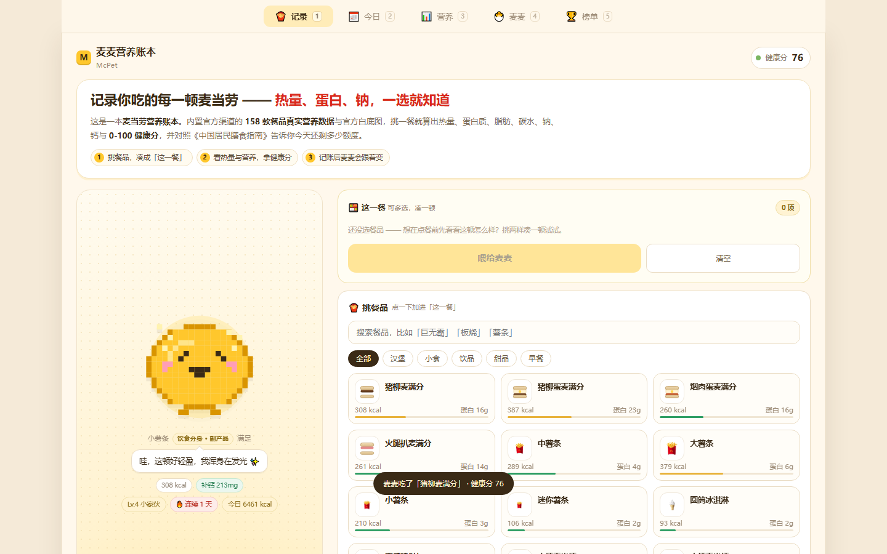
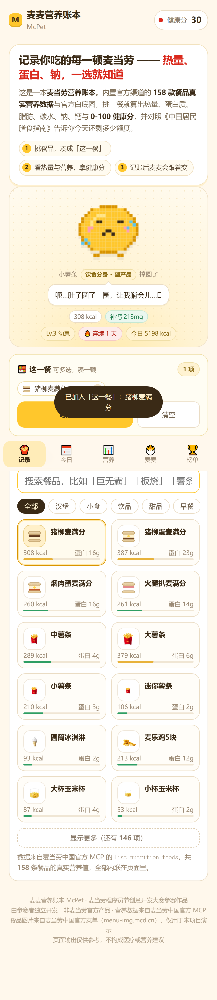
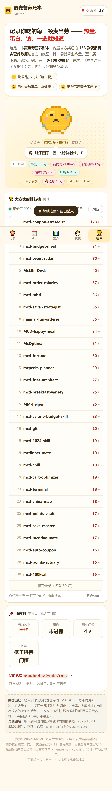
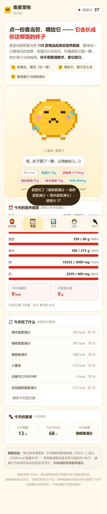
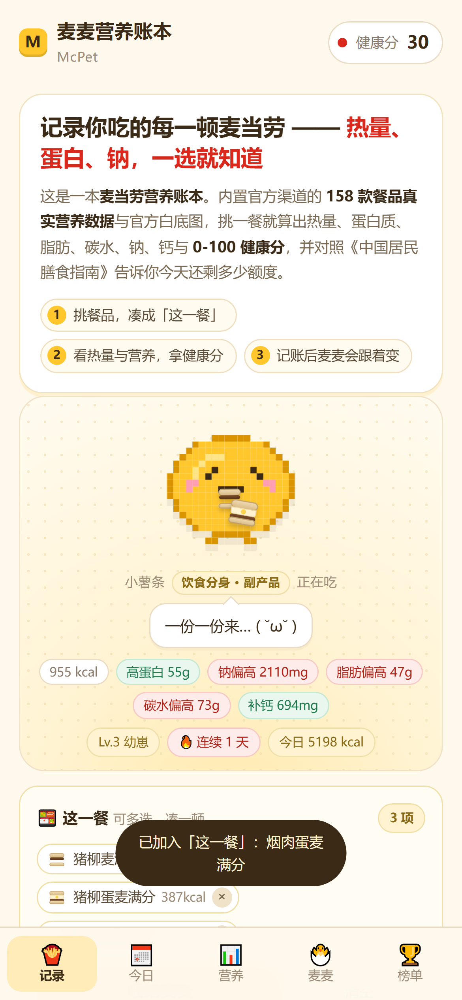

<div align="center">

# 🍟 麦麦营养账本 McPet

**记下你吃的每一顿麦当劳 —— 热量、蛋白、钠，一选就知道。**

用麦当劳官方 MCP 的**真实营养数据**记账：挑一餐就算出六维营养与 **0-100 健康分**，<br>
对照《中国居民膳食指南》告诉你今天还剩多少额度，并给出「**那我该怎么办**」的具体动作。

[**🎮 立即体验（零配置，打开就用）**](https://zhangjunzhe349-coder.github.io/mcpet/) ·
[实时榜单](#-大赛实时榜单) · [技术架构](#-技术架构) · [参赛声明](CONTEST_DECLARATION.md)




<p>
  
  
  
  
</p>

</div>

---

## 这是什么

**一本麦当劳营养账本。** 不是点单工具，也不是外卖聚合器 —— 它只做一件事：
**把你吃下去的每一顿，换算成看得懂的热量、蛋白、脂肪、碳水、钠、钙和健康分。**

打开就能用：158 款餐品的真实营养值（来自麦当劳中国官方 MCP）全部内联在页面里，
挑餐品 → 实时看到这一餐的六维营养 + 健康分 + 雷达图 → 记账 → 今天的额度自动扣减。

| 它回答的问题 | 怎么回答 |
|---|---|
| 这一顿吃下去多少热量？ | 点餐品即刻出数，**点餐前**就能预演这顿的代价 |
| 营养结构合理吗？ | 六维条形图 + 雷达图，一眼看出哪项拖后腿 |
| 今天还剩多少额度？ | 对照《中国居民膳食指南（2022）》，实时算「还能吃多少 kcal / 还差多少 g 蛋白」 |
| 那我该怎么办？ | **搭配顾问**直接给动作：加什么、拿掉什么、换成什么 |
| 长期吃成什么样了？ | 最近 12 餐的体态曲线，由**麦麦**（副产物）帮你可视化 |

> **麦麦只是一本账本的封面上那只吉祥物。**
> 它是「你最近吃得怎么样」的可视化分身 —— 吃太油它会圆，钠太高它会喊渴；
> 但它**不是主角**：主角永远是你吃进去的那 6 个数字。

---

## 三个核心能力

### 1️⃣ 记账 —— 快，且不用动脑

- **「这一餐」组合篮子**：像点单一样把汉堡 + 薯条 + 饮料加进去（上限 8 件），
  实时看到整餐的六维营养、健康分与雷达图。**点餐前就能预演这顿的代价。**
- **一次只做一件事**：选餐品 → 看数字 → 记账。没有多余的按钮和跳转。
- **今天的额度**：按《中国居民膳食指南（2022）》2000 kcal 水平的成人参考值累计，
  直接告诉你「今天还能吃 XXX kcal」「还差 XX g 蛋白质」，超额项标红。
- **饮食报告**：把 WorkBuddy 里 `order-list` 返回的订单贴回来，
  一键生成「识别到 N 种餐品 · 平均健康分 · 合计热量 · 最高钠来源」的报告。**你的真实消费也能复盘。**

### 2️⃣ 会看懂 —— 官方白底图 + 规格差异

- **官方白底图**：126 条餐品直接用**麦当劳官方菜单图**（`query-meals` 返回的
  `menu-img.mcd.cn` 白底商品图），跟点餐 APP 上看到的一模一样，不用读名字就知道是什么。
  匹配走四级（精确 → 人工别名 → 去尺寸词 → 核心词），**多门店菜单聚合**取最全图库；
  图格**统一白底**，实拍图与手绘兜底同底色，视觉一致。
- **规格看得出差别**：小/中/大/迷你薯条、小/中/大杯、4 块/5 块麦乐鸡、香芋派/菠萝派 ——
  大小、块数、馅料颜色都跟着变，**不会再出现「四个薯条长得一模一样」**。
- **剩下的 94 条手绘兜底**：按品类程序化绘制 27 类图标（汉堡/鸡块/鸡翅/派/咖啡/雪冰/粥…），
  按名字驱动，绝不会有破图。图片加载失败会自动回落到手绘。

### 3️⃣ 有反馈 —— 麦麦（副产物，但会让人想再打开一次）

- **看完数字，麦麦会说话**：高蛋白·热量适中 → ✨「这顿好轻盈」；
  热量超标 → 🥲「肚子圆了一圈」；钠太高 → 💧「好咸！我要喝水」；碳水太高 → 😴「想躺平」。
- **有记账感**：点「记账」以后，餐品会**一件一件从下方飞进麦麦嘴里**，
  在嘴边缩小消失、张嘴咀嚼、飘出这份的热量。不是贴图切换，是真的看着它被吃掉。
- **体态由最近 12 餐决定**：热量/脂肪/钠越高越圆 —— 腰围是算出来的，不是换图。
  10 级成长、12 项成就、可改名、可导出养成卡。

### 附：零门槛

单个 HTML 文件，**零依赖、零构建、零 Token**。双击就开，丢到任何静态托管都能跑。

---

## 🏆 大赛实时榜单

页面**内置了比赛官方排行榜的实时读取**，不是截图、不用手输地址：

- 每次打开页面（或点「刷新」）会去拉比赛仓库最新的 `RANKING.md`；
- **点任意一行，直接跳转到那个项目对应的 GitHub 仓库**（仓库地址来自 460 条报名 Issue 的自动解析）；
- 「我在哪」一栏实时显示本项目的名次 / 星数 / 距进榜门槛还差几颗；
- 拉不到网络时退回构建时内置的快照，并且**如实标注是「缓存」还是「实时」**。

> 数据链路：`contents/RANKING.md`（`api.github.com`，带 CORS）→ 解析表格 → 与 Issue 清单解析出的
> 「项目名 → owner/repo」映射（597 个键）配对 → 渲染成可点击的列表。
> 没匹配到仓库的项目**只显示名字、不给链接** —— 不猜、不编造。

---

## 手机 / 电脑是两套布局

不是把手机页面放大：

| | 手机（< 1024px） | 电脑（≥ 1024px） |
|---|---|---|
| 导航 | 底部 Tab，单手可及 | **顶部横向导航，支持数字键 `1`~`5` 切换** |
| 版式 | 单列纵向流 | **双栏工作台：左栏麦麦常驻，右栏账本铺开** |
| 麦麦 | 紧凑舞台（首屏占比 < 45%） | **滚动右侧数据时它一直停在视野里** |
| 内容密度 | 大按钮、大触摸目标（≥44px） | 卡片自动铺两列，挑餐品网格升 3 列 |

两种尺寸**各自独立断言**，改一边不会碰坏另一边。

---

## ⚔️ 和同类比好在哪

比赛里已经有两个「麦当劳桌宠」。我们的定位和它们不一样 —— **它们养宠物，我们记账**：

| 维度 | mcdonald-pet「麦麦猫」 | mcd-pet-feeder「麦门饲养员」 | **麦麦营养账本** |
|---|---|---|---|
| 第一眼是什么 | 桌宠 | 桌宠 | ✅ **营养账本**（数字在前，宠物在后） |
| 运行门槛 | 要跑 Python 服务 | macOS + PyQt 依赖 | ✅ **单文件 HTML，双击/打开网页即用** |
| 资产体积 | 181 文件 / 8.6 MB 手绘帧 | 327 文件 / 5.6 MB | ✅ **官方白底图 + Canvas 程序化绘制** |
| 营养维度 | 卡路里 + 花费 | 花费 / 券省 / 连吃天数 | ✅ **六维营养（热量/蛋白/脂肪/碳水/钠/钙）** |
| 数据覆盖 | 12 道餐品 | 全菜单 | ✅ **158 条官方营养表全量 + 126 条官方配图** |
| 用法时机 | 吃完后 | 桌面上 | ✅ **点餐前** —— 「这一餐」组合 + 每日额度 + 搭配顾问 |

与营养类标杆 `mcd-order-calories`（总榜第 3）的关系是**互补**：
它回答「**我这个月吃进去多少卡**」（回望历史订单），本账本回答「**这一口下去会占掉今天的多少额度**」（当下即可决策）。
我们抄了它最值得抄的一件事 —— **诚实披露不确定性**：本页只使用 MCP 提供的 6 个字段，
没有的指标（游离糖、膳食纤维、加工程度）**一律不估算、不编造**，健康分也明确标注为「启发式评分，非医学建议」。

---

## 怎么用

1. 打开 [Demo 页面](https://zhangjunzhe349-coder.github.io/mcpet/)（**不需要 Token，不需要配置**）
2. 在「记录」里挑餐品 —— 支持**多选**，凑成一顿完整的（汉堡 + 薯条 + 可乐）
3. 「这一餐」实时显示健康分、雷达图和搭配建议
4. 点「记账」（= 喂给麦麦）→ 计入今天的营养额度，也计入麦麦的体态
5. 切「今日」看今天的额度与剩余空间；切「营养」看逐项雷达与条形图；切「麦麦」看等级 / 体态 / 成就
6. 想复盘真实消费 → 在「今日」底部展开导入框，粘贴 `order-list` 结果生成**饮食报告**
7. 切「榜单」看大赛实时排名，点一行直达那个项目的仓库

---

## 🔧 技术架构

```
┌──────────────────────────────────────────────────────────────┐
│  浏览器（index.html · 单文件 · 零依赖）                        │
│  ├─ 记账引擎：篮子 → 六维营养 + 健康分 + 搭配顾问               │
│  ├─ 每日额度：对照《中国居民膳食指南（2022）》                  │
│  ├─ 营养可视化：SVG 雷达图 + 逐项对照条形图                     │
│  ├─ 食物视觉：官方白底图优先 → 手绘图标兜底（27 类 · 规格驱动）  │
│  ├─ 参数化像素麦麦：体型 = f(等级, 近期饮食)  ← 程序化生成       │
│  ├─ 累计账本：localStorage（历史餐次 / 连续天数 / 成就）         │
│  └─ 内联数据：营养表 158 条 + 配图索引 126 条 + 榜单快照与仓库映射 │
└──────────────────────────────────────────────────────────────┘
        ▲ 构建时内联            ▲ 页面加载时实时拉取
        │                       │
┌───────────────────────┐  ┌───────────────────────────────────┐
│ 麦当劳中国官方 MCP      │  │ 比赛仓库（api.github.com）          │
│ https://mcp.mcd.cn     │  │ ├─ contents/RANKING.md ← 实时榜单   │
│ ├─ list-nutrition-foods│  │ └─ issues（460 条报名）← 仓库映射    │
│ │   ← 核心：158 条营养  │  └───────────────────────────────────┘
│ └─ query-meals         │
│     ← 官方菜单白底图    │
└───────────────────────┘
```

### 麦麦是怎么"算"出来的

早期版本的身体是一个写死的 20×20 字符矩阵，只能"胖"或"不胖"。现在它是**算出来的**：

```js
// 纵向归一位置 t ∈ [-1,1]，半宽 = 8.3·√(1-t²)·girth  → 一个可伸缩的椭圆团
function buildBody(girth){ /* ... 20×20 网格 ... */ }

// girth（腰围）由最近 12 餐的热量 / 脂肪 / 钠决定
function habitFat(){
  const r = S.meals.slice(-12);
  return clamp(avgK/900*0.6 + avgF/40*0.4 + avgS/2000*0.06, 0, 1);
}
girth = clamp(0.84 + 0.42*fat, 0.80, 1.24);   // 0.80 清瘦 … 1.24 圆润
```

所以「长胖」是**真的长胖**：不是切换一张贴图，而是每一行的宽度都变了。
喂食瞬间还会先「弹」一下再回落到新的基线 —— 快变的即时反应 + 慢变的累计体态，两条时间线叠加。

### 为什么 Demo 不用 Token 也能用

`list-nutrition-foods` **没有入参**，返回的是一张**不随门店变化的全量表**（实测 158 条去重餐品）；
`query-meals` 返回的官方商品图是**免 referer 的公开 CDN 图**（`menu-img.mcd.cn`）。
既然都是静态资源，构建时快照进 `data/` 并内联/落地到 `assets/food/`，
就能实现官方要求的「**零门槛体验入口：打开网页就能用**」。

需要 Token 的能力（领券 / 活动 / 门店 / 订单）**不在前端硬编码调用** ——
页面生成一段指令，由你在 WorkBuddy 里执行，MCP 调用发生在 Agent 侧。
这样既保证「真实使用 MCP」，又不需要把 Token 交给浏览器。

详见 [MCP_INTEGRATION.md](MCP_INTEGRATION.md)。

## 健康分怎么算

满分 100，五个维度分段线性评分，越健康越高：

| 维度 | 满分 | 满分线 | 归零线 |
|---|---:|---|---|
| 蛋白质 | 30 | ≥ 25 g | — |
| 热量 | 25 | ≤ 250 kcal | ≥ 1100 kcal |
| 钠 | 20 | ≤ 400 mg | ≥ 2000 mg |
| 脂肪 | 15 | ≤ 10 g | ≥ 60 g |
| 碳水 | 10 | ≤ 35 g | ≥ 120 g |

评级：**S** ≥85 · **A** ≥70 · **B** ≥55 · **C** ≥40 · **D** <40

> ⚠️ **这是本项目自拟的启发式评分，不是医学指标。** 每日参考值取自
> 《中国居民膳食指南（2022）》成人（2000 kcal 能量水平）。输出仅供参考，不构成医疗或营养建议。

## 快速开始

### 方式一：直接用（推荐）

下载 `index.html`，双击打开。就这一个文件，没有依赖、没有构建。

```bash
curl -O https://raw.githubusercontent.com/zhangjunzhe349-coder/mcpet/main/index.html
open index.html      # Windows: start index.html
```

### 方式二：本地改代码

```bash
git clone https://github.com/zhangjunzhe349-coder/mcpet.git
cd mcpet

# ① 抓官方菜单白底图（需 MCP Token，产物直接落 assets/food/）
python tools/fetch-food-photos.py

# ② 生成榜单索引：仓库映射 + 离线快照（走 api.github.com，免 Token）
python tools/fetch-rank-index.py

# ③ 模板 + 数据 → 单文件页面
python tools/build.py

# ④ 无头浏览器全量校验（135 项断言：渲染 / 图标 / 规格差异 / 投喂动画 /
#    养成持久化 / 实时榜单 / 手机 + 桌面双端 / 截图）
node tools/browser-check.js
```

> `tools/build.py` 里内置了一道**防漂移体检**：`src/icons.part.js` 与 `src/rank.part.js`
> 已手工并入模板，如果只改了 partial 而没同步模板，构建时会直接告警 —— 避免改了不生效。

### 方式三：接到你自己的 WorkBuddy 里

把 `SKILL.md` 放进你的技能目录，就可以直接对 WorkBuddy 说
「帮我记一下今天吃了巨无霸加中薯条，看下健康分」。

## 项目结构

```
mcpet/
├── index.html                  ← 构建产物：单文件 Demo（可直接部署/分享）
├── SKILL.md                    ← Agent Skill 定义
├── MCP_INTEGRATION.md          ← MCP 接入说明：工具、调用流程、业务价值
├── mcp-config.example.json     ← MCP 配置示例（仅环境变量占位符）
├── workbuddy.md                ← WorkBuddy 开发对话上下文
├── CONTEST_DECLARATION.md      ← 参赛声明（官方原文）
├── LICENSE                     ← MIT
├── data/
│   ├── nutrition.json          ← MCP 营养数据快照（158 条）
│   ├── food-photos.json        ← 官方白底图索引（126 条 → assets/food/）
│   └── rank-index.json         ← 榜单离线快照 + 「项目名→仓库」映射（597 键）
├── src/
│   ├── index.template.html     ← 页面源文件（含数据占位符）
│   ├── icons.part.js           ← 食物视觉系统（品类 / 规格 / 块数解析 + 27 类手绘）
│   └── rank.part.js            ← 实时榜单模块（拉取 / 解析 / 缓存 / 渲染）
├── tools/
│   ├── build.py                ← 构建：模板 + 数据 → index.html（含防漂移体检）
│   ├── fetch-food-photos.py    ← 抓官方菜单白底图 → 96×96 WebP
│   ├── fetch-rank-index.py     ← 生成榜单快照与仓库映射
│   └── browser-check.js        ← 无头浏览器全量校验（135 项断言）
└── assets/
    ├── food/                   ← 官方白底图（55 个去重文件 / 121 KB）
    └── screenshot-*.png
```

## 数据来源与诚实边界

营养数据全部来自**麦当劳中国官方 MCP** 的 `list-nutrition-foods`（158 条，构建时快照内联）；
商品配图来自同一个 MCP 的 `query-meals` 返回的官方菜单图。字段与单位：

| 字段 | 单位 | 说明 |
|---|---|---|
| `energyKj` / `energyKcal` | kJ / kcal | 能量（本页以 kcal 展示） |
| `protein` | g | 蛋白质 |
| `fat` | g | 脂肪 |
| `carbohydrate` | g | 碳水化合物 |
| `sodium` | mg | 钠 |
| `calcium` | mg | 钙 |

**本页不编造的东西**：MCP 不提供的指标（游离糖、膳食纤维、饱和/反式脂肪、加维生素明细、加工程度评分）
一律留空不估算；榜单里没匹配到仓库的项目只显示名字不给链接；网络不通时榜单会明确标注是「缓存/快照」而不是「实时」。

## 隐私

账本数据（餐次记录 / 连续天数 / 成就 / 麦麦的名字）与榜单缓存
**只存在你自己浏览器的 localStorage 里**，不会上传到任何服务器，也不含任何身份信息。
换设备或清缓存会重置。

---

<div align="center">

**如果这本账本让你多看了一眼营养表，点个 ⭐ Star 就是最好的鼓励 —— 本次比赛以 Star 数排名。**

**麦麦营养账本 McPet** · 麦当劳程序员节创意开发大赛参赛作品

本项目由参赛者独立开发，**非麦当劳官方产品**。<br>
页面输出仅供参考，不构成医疗、营养或其他专业建议。<br>
餐品信息、价格及供应状态以麦当劳官方渠道的实时结果为准。

MIT License © 2026 张俊哲 (Jayzen)

</div>
