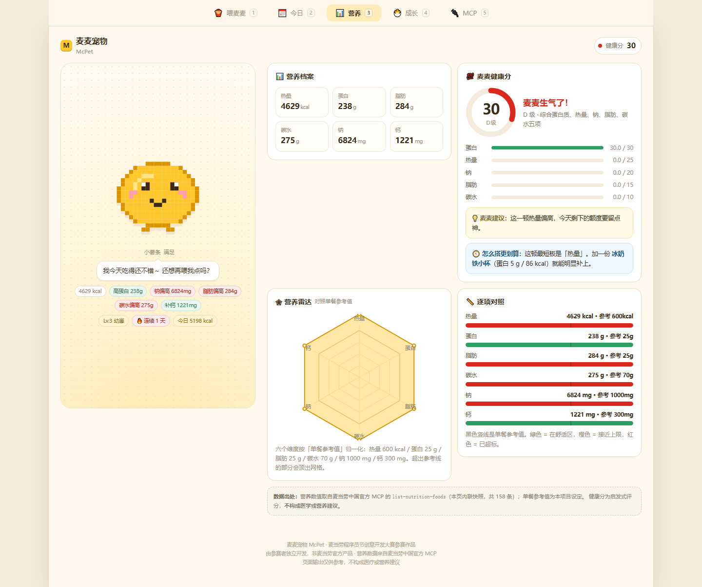
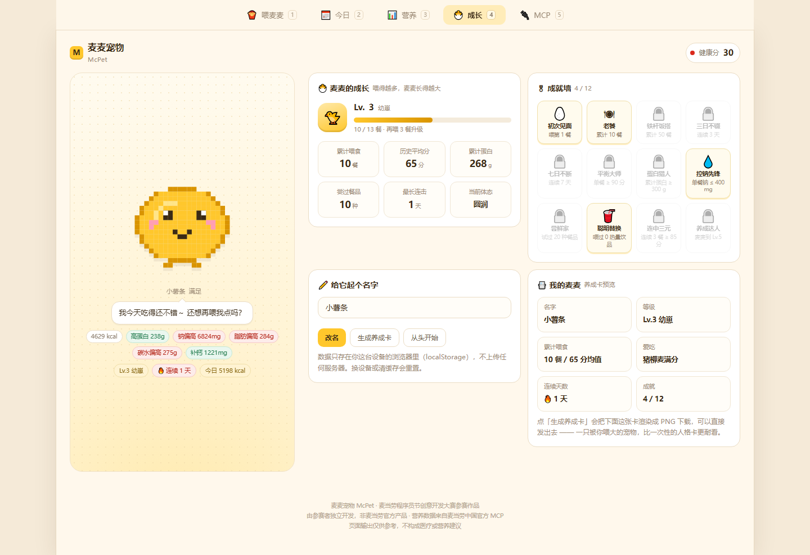
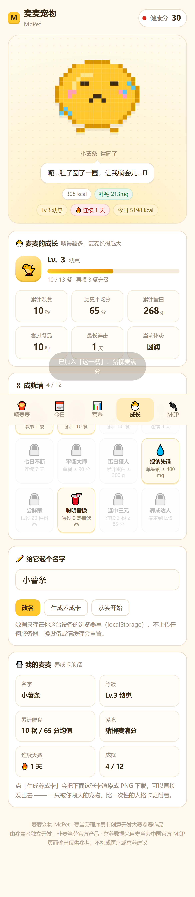

<div align="center">

# 🍔 麦麦宠物 McPet

**点麦当劳 = 喂宠物。**

用麦当劳官方 MCP 的**真实营养数据**驱动一只像素小宠物：<br>
你吃什么，它就变成什么样 —— 吃太油它会长胖，吃得好它浑身发光，太久不理它它会饿。

[**🎮 立即体验（零配置，打开就玩）**](https://zhangjunzhe349-coder.github.io/mcpet/) ·
[技术架构](#-技术架构) · [和同类比好在哪](#-和同类比好在哪) · [参赛声明](CONTEST_DECLARATION.md)


<p>
  
  
  
</p>

</div>

---

## 这是什么

一只叫**麦麦**的像素小宠物住在这个网页里。你选麦当劳餐品喂它，它会根据这份餐品的
**真实营养数据**（热量 / 蛋白质 / 脂肪 / 碳水 / 钠 / 钙）给出不同反应：

| 你这餐的情况 | 麦麦的反应 |
|---|---|
| 高蛋白 · 热量适中 | 浑身发光 ✨「这顿好轻盈，我浑身在发光」 |
| 热量超标 | 肚子撑圆 🥲「呃…肚子圆了一圈，让我躺会儿」 |
| 钠太高 | 吐舌头流汗 💧「好咸好咸！我要喝水！！」 |
| 碳水太高 | 眼皮下沉 😴「碳水好高…想躺平」 |

它不是一个查表工具 —— 它**会记住你喂过什么**，然后慢慢变成你的饮食习惯的样子。

> 表面上是养宠物，**本质是一个营养健康分析工具** —— 只不过它让你愿意每天都打开。

---

## 三个核心能力

### 1️⃣ 实用营养 —— 能直接指导下一顿

不是只给一个分数，而是回答「**那我该怎么办**」：

- **「这一餐」组合篮子**：像点单一样把汉堡 + 薯条 + 饮料加进去，实时看到整餐的六维营养、
  健康分与雷达图。**点餐前就能预演这顿的代价。**
- **每日营养额度**：按《中国居民膳食指南（2022）》的每日参考值累计今天吃进多少，
  直接告诉你「今天还能吃 XXX kcal」「还差 XX g 蛋白质」。
- **搭配顾问**：自动指出这顿**最短板是哪一项**，并给出具体动作 ——
  「最短板是蛋白质，加一份麦麦脆汁鸡（琵琶腿 21 g）就能明显补上」，
  或者「钠主要来自芝士双层安格斯厚牛堡，把它拿掉整餐立刻变清爽」。

### 2️⃣ 情绪价值 —— 会变、会饿、有脾气

- **累计养成**：喂得越多，麦麦从 🥚 蛋期一路长到 🌟 麦麦之星，共 10 个等级。
- **体态会变**：这不是一张静态图片。它的**腰围由你最近 12 餐的热量与脂肪决定** ——
  天天高热量会肉眼可见地变圆润，吃得清爽就一直是匀称的。
- **会饿**：超过 6 小时没喂会开始抱怨，超过 12 小时会真的饿。
- **12 项成就**：初次见面 / 老饕 / 三日不辍 / 蛋白猎人 / 控钠先锋 / 尝鲜家 …
- **可以改名、可以导出养成卡**：一键把麦麦的成长渲染成 PNG 分享出去。

### 3️⃣ 零门槛 —— 打开就能玩，不需要任何配置

单个 HTML 文件，**零依赖、零构建、零 Token、零网络请求**。
双击就能开，丢到任何静态托管都能跑，微信里点开也能玩。

**手机和电脑是两套布局，不是把手机页面放大：**

| | 手机（< 1024px） | 电脑（≥ 1024px） |
|---|---|---|
| 导航 | 底部 Tab，单手可及 | **顶部横向导航，支持数字键 `1`~`5` 切换** |
| 版式 | 单列纵向流 | **双栏工作台：左栏宠物常驻，右栏数据铺开** |
| 宠物 | 顶部固定舞台 | **滚动右侧数据时它一直停在视野里** |
| 内容密度 | 大按钮、大触摸目标（≥44px） | 卡片自动铺两列，挑餐品网格升 3 列 |

电脑版不是"把窄条居中"，而是把手机端的纵向流重构成符合桌面认知的信息架构 ——
两种尺寸各自独立断言，改一边不会碰坏另一边。

---

## ⚔️ 和同类比好在哪

比赛里已经有两个「麦当劳桌宠」（都在我们上线后当天创建）。我们和它们的区别：

| 维度 | mcdonald-pet「麦麦猫」 | mcd-pet-feeder「麦门饲养员」 | **McPet** |
|---|---|---|---|
| 运行门槛 | 要跑 Python 服务 | macOS + PyQt 依赖 | ✅ **单文件 HTML，双击/打开网页即玩** |
| 资产体积 | 181 文件 / 8.6 MB 手绘帧 | 327 文件 / 5.6 MB | ✅ **Canvas 程序化生成，0 素材** |
| 累计变化 | 吃多会长胖 | 饥饿值衰减 + 吃麦日记 | ✅ **10 级成长 + 体态随热量/脂肪连续变化 + 饥饿衰减 + 成就** |
| 营养维度 | 卡路里 + 花费 | 花费 / 券省 / 连吃天数 | ✅ **六维营养（热量/蛋白/脂肪/碳水/钠/钙）** |
| 数据覆盖 | 12 道餐品 | 全菜单 | ✅ **158 条官方营养表全量** |
| 用法时机 | 吃完后 | 桌面上 | ✅ **点餐前** —— 「这一餐」组合 + 每日额度 + 搭配顾问 |

与营养类标杆 `mcd-order-calories`（36★，总榜第 3）的关系是**互补而非竞争**：
它回答「**我这个月吃进去多少卡**」（回望历史订单），McPet 回答「**这一口下去我会变成什么样**」（当下 + 累计）。
我们抄了它最值得抄的一件事 —— **诚实披露不确定性**：本页只使用 MCP 提供的 6 个字段，
没有的指标（游离糖、膳食纤维、加工程度）**一律不估算、不编造**，健康分也明确标注为「启发式评分，非医学建议」。

---

## 怎么玩

1. 打开 [Demo 页面](https://zhangjunzhe349-coder.github.io/mcpet/)（**不需要 Token，不需要配置**）
2. 在「喂麦麦」里挑餐品 —— 支持**多选**，可以凑一顿完整的（汉堡 + 薯条 + 可乐）
3. 「这一餐」里实时看整餐的健康分、雷达图和搭配建议
4. 点「喂给麦麦」→ 麦麦吃掉，计入今天的营养额度，也计入它的成长
5. 切到「今日」看今天的营养额度和剩余空间；切到「成长」看等级、体态和成就
6. 想深入自己的真实消费 → 切到「MCP」，复制指令到 WorkBuddy 执行 `order-list`，
   把结果贴回来生成一份**饮食报告**

<p align="center">
  
  
</p>

---

## 🔧 技术架构

```
┌──────────────────────────────────────────────────────────────┐
│  浏览器（index.html · 单文件 · 零依赖）                        │
│  ├─ 参数化像素宠物：体型 = f(等级, 近期饮食)  ← 完全程序化生成   │
│  ├─ 累计养成账本：localStorage（历史餐次 / 连续天数 / 成就）     │
│  ├─ 麦麦健康分算法：蛋白30 + 热量25 + 钠20 + 脂肪15 + 碳水10    │
│  ├─ 每日营养额度：对照《中国居民膳食指南（2022）》              │
│  ├─ 营养可视化：SVG 雷达图 + 逐项对照条形图                     │
│  └─ 内联营养数据集快照（158 条 × 9 字段）                       │
└──────────────────────────────────────────────────────────────┘
                          ▲
        list-nutrition-foods 的快照（构建时内联）
                          │
┌──────────────────────────────────────────────────────────────┐
│  麦当劳中国官方 MCP · https://mcp.mcd.cn                      │
│  ├─ list-nutrition-foods   ← 核心：营养数据（无入参）           │
│  ├─ auto-bind-coupons      ← 一键领券                         │
│  ├─ campaign-calendar      ← 活动日历                         │
│  ├─ query-nearby-stores    ← 附近门店                         │
│  └─ order-list             ← 历史订单 → 饮食报告               │
└──────────────────────────────────────────────────────────────┘
```

### 宠物是怎么"参数化"的

早期版本的身体是一个写死的 20×20 字符矩阵，只能"胖"或"不胖"。
现在它是**算出来的**：

```js
// 纵向归一位置 t ∈ [-1,1]，半宽 = 8.3·√(1-t²)·girth  → 一个可伸缩的椭圆团
function buildBody(girth){ /* ... 20×20 网格 ... */ }

// girth（腰围）由最近 12 餐的热量 / 脂肪 / 钠决定
function habitFat(){
  const r = S.meals.slice(-12);
  return clamp(avgK/900*0.6 + avgF/40*0.4 + avgS/2000*0.06, 0, 1);
}
girth = clamp(0.84 + 0.42*fat, 0.80, 1.24);   // 0.80 清瘦 … 1.24 圆润
scale = 0.80 → 1.00                            // 由等级决定，越喂越大
```

所以「长胖」是**真的长胖**：不是切换一张贴图，而是每一行的宽度都变了。
喂食瞬间还会先「弹」一下再回落到新的基线 —— 快变的即时反应 + 慢变的累计体态，两条时间线叠加。

### 为什么 Demo 不用 Token 也能玩

`list-nutrition-foods` **没有入参**，返回的是一张**不随门店变化的全量表**
（实测 158 条去重餐品）。既然它是静态数据，构建时把它快照进 `data/nutrition.json`
并内联到页面，就能实现官方要求的「**零门槛体验入口：打开网页就能玩**」。

而需要 Token 的能力（领券 / 活动 / 门店 / 订单）**不在前端硬编码调用** ——
页面生成一段指令，由你在 WorkBuddy 里执行，MCP 调用发生在 Agent 侧。
这样既保证「真实使用 MCP」，又不需要把 Token 交给浏览器。

详见 [MCP_INTEGRATION.md](MCP_INTEGRATION.md)。

## 麦麦健康分怎么算

满分 100，五个维度分段线性评分，越健康越高：

| 维度 | 满分 | 满分线 | 归零线 |
|---|---:|---|---|
| 蛋白质 | 30 | ≥ 25 g | — |
| 热量 | 25 | ≤ 250 kcal | ≥ 1100 kcal |
| 钠 | 20 | ≤ 400 mg | ≥ 2000 mg |
| 脂肪 | 15 | ≤ 10 g | ≥ 60 g |
| 碳水 | 10 | ≤ 35 g | ≥ 120 g |

评级：**S** ≥85 · **A** ≥70 · **B** ≥55 · **C** ≥40 · **D** <40

算法实现在 `src/index.template.html` 的 `healthScore()`，欢迎按自己的标准改。

> ⚠️ **这是本项目自拟的启发式评分，不是医学指标。** 每日参考值取自
> 《中国居民膳食指南（2022）》成人（2000 kcal 能量水平）。页面输出仅供参考，不构成医疗或营养建议。

## 快速开始

### 方式一：直接用（推荐）

下载 `index.html`，双击打开。就这一个文件，没有依赖、没有构建、没有网络请求。

```bash
curl -O https://raw.githubusercontent.com/zhangjunzhe349-coder/mcpet/main/index.html
open index.html      # Windows: start index.html
```

### 方式二：本地改代码

```bash
git clone https://github.com/zhangjunzhe349-coder/mcpet.git
cd mcpet

# 从模板 + 数据集重新生成单文件页面
python tools/build.py

# 无头浏览器全量校验（渲染 / 交互 / 养成持久化 / 手机适配 / 桌面适配 / 截图）
node tools/browser-check.js
```

### 方式三：接到你自己的 WorkBuddy 里

把 `SKILL.md` 放进你的技能目录（详见 [SKILL.md](SKILL.md)），
就可以直接对 WorkBuddy 说「喂麦麦吃一份巨无霸，看看它健康分多少」。

## 项目结构

```
mcpet/
├── index.html                  ← 构建产物：单文件 Demo（可直接部署/分享）
├── SKILL.md                    ← Agent Skill 定义（让 WorkBuddy 会用「麦麦宠物」）
├── MCP_INTEGRATION.md          ← MCP 接入说明：工具、调用流程、业务价值
├── mcp-config.example.json     ← MCP 配置示例（仅环境变量占位符）
├── workbuddy.md                ← WorkBuddy 开发对话上下文
├── CONTEST_DECLARATION.md      ← 参赛声明（官方原文）
├── LICENSE                     ← MIT
├── data/
│   └── nutrition.json          ← MCP 营养数据快照（158 条 × 9 字段）
├── src/
│   └── index.template.html     ← 页面源文件（含占位符）
├── tools/
│   ├── build.py                ← 构建：模板 + 数据 → index.html
│   └── browser-check.js        ← 无头浏览器全量校验（99 项断言，含桌面端）
└── assets/
    └── screenshot-*.png
```

## 数据来源

全部营养数据来自**麦当劳中国官方 MCP** 的 `list-nutrition-foods` 工具，
经 `tools/build.py` 快照内联。数据字段与单位：

| 字段 | 单位 | 说明 |
|---|---|---|
| `energyKj` / `energyKcal` | kJ / kcal | 能量（本页以 kcal 展示） |
| `protein` | g | 蛋白质 |
| `fat` | g | 脂肪 |
| `carbohydrate` | g | 碳水化合物 |
| `sodium` | mg | 钠 |
| `calcium` | mg | 钙 |

> MCP 不提供的数据（本页也不编造）：游离糖、膳食纤维、饱和/反式脂肪、加维生素明细、加工程度评分。

## 隐私

养成数据（喂食记录 / 连续天数 / 成就 / 宠物名字）**只存在你自己浏览器的 localStorage 里**，
不会上传到任何服务器，也不含任何身份信息。换设备或清缓存会重置。

---

<div align="center">

**如果麦麦让你多看了一眼营养表，点个 ⭐ Star 就是最好的鼓励 —— 本次比赛以 Star 数排名。**

**麦麦宠物 McPet** · 麦当劳程序员节创意开发大赛参赛作品

本项目由参赛者独立开发，**非麦当劳官方产品**。<br>
页面输出仅供参考，不构成医疗、营养或其他专业建议。<br>
餐品信息、价格及供应状态以麦当劳官方渠道的实时结果为准。

MIT License © 2026 张俊哲 (Jayzen)

</div>
